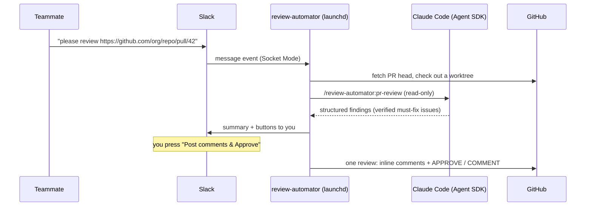

# review-automator

Share a pull request link in Slack, get a Claude Code review in your DMs, and post it to GitHub — inline
comments plus an approval — with one click, from your own account.



- **Your review style.** Reviews run as a Claude Code session with your `~/.claude` skills and agents
  loaded. Use the bundled read-only reviewers, or point the config at your own.
- **Nothing is posted without you.** Every review waits for a button press by you, in Slack.
- **Approval is decided by code, not the model.** No must-fix issue → `APPROVE` with
  `LGTM!! :+1:`. A verified must-fix issue → `COMMENT` (or `REQUEST_CHANGES`), never approval.
- **Runs on your Mac** as a LaunchAgent. No public URL, no GitHub token in config — posting uses the
  `gh` CLI you are already logged in with.

## Requirements

- macOS, Node.js ≥ 22, `git`, [`gh`](https://cli.github.com) logged in (`gh auth login`)
- Claude Code logged in on this Mac (the Agent SDK uses the same credentials)
- A Slack workspace where you can create an app

## Setup

1. **Install**

   ```bash
   git clone https://github.com/otajisan/review-automator.git
   cd review-automator
   pnpm install && pnpm build
   ```

2. **Create the Slack app** at <https://api.slack.com/apps> → _Create New App_ → _From a manifest_,
   and paste [`slack-manifest.yaml`](slack-manifest.yaml). Then:
   - _Basic Information → App-Level Tokens_: create a token with `connections:write` (`xapp-…`)
   - _Install App_: install to the workspace and copy the _Bot User OAuth Token_ (`xoxb-…`)
   - Invite the bot (`/invite @review-automator`) to every channel it should watch **and** to the
     notification channel

3. **Configure** (never commit these files)

   ```bash
   mkdir -p ~/.config/review-automator
   cp config.example.yaml ~/.config/review-automator/config.yaml
   cp .env.example ~/.config/review-automator/.env && chmod 600 ~/.config/review-automator/.env
   ```

   Fill in the tokens in `.env`, and your Slack member ID, GitHub login, channel IDs and
   `allowed_repos` in `config.yaml`.

4. **Check the setup** — no model calls are made:

   ```bash
   pnpm check-setup
   ```

5. **Try one review without Slack** — prints what would be posted, posts nothing:

   ```bash
   pnpm review-once https://github.com/your-org/your-repo/pull/123
   ```

6. **Run it under launchd**

   ```bash
   ./scripts/install-launchd.sh
   tail -f ~/Library/Logs/review-automator/review-automator.log
   ```

   Re-run the script after `git pull && pnpm build` to restart. `./scripts/uninstall-launchd.sh` stops it.

## How it behaves

| Situation                                                                               | What happens                                                                                                                                                                                                                                                                    |
| --------------------------------------------------------------------------------------- | ------------------------------------------------------------------------------------------------------------------------------------------------------------------------------------------------------------------------------------------------------------------------------- |
| A message in a watched channel contains a PR link                                       | The PR is reviewed (one at a time by default). When the review starts, `notify_channel` gets “Started reviewing …” (`slack.started_message`). Nothing is posted in the watched channel                                                                                          |
| A message links several PRs                                                             | Each PR is reviewed and notified separately                                                                                                                                                                                                                                     |
| The poster is in `slack.ignored_requesters`                                             | Ignored                                                                                                                                                                                                                                                                         |
| The message matches `slack.ignore_message_patterns` (e.g. a merge/release announcement) | Ignored                                                                                                                                                                                                                                                                         |
| The PR was merged or closed while the review waited                                     | Dropped quietly; if the review had already started, the reason is replied in the thread of its start message                                                                                                                                                                    |
| The same PR head was already reviewed                                                   | Ignored. After a new push, it is reviewed again                                                                                                                                                                                                                                 |
| The PR is merged, closed or a draft                                                     | Ignored (drafts: unless `github.skip_drafts: false`)                                                                                                                                                                                                                            |
| You already approved the PR's current head                                              | Ignored (unless `github.skip_approved_by_owner: false`). Commits after your approval that only merge the base branch in still count as approved, as long as the PR's own changes are identical (a conflict resolution in a merge is reviewed); any other new commit is reviewed |
| Review finished                                                                         | Summary + buttons in `notify_channel`, mentioning you                                                                                                                                                                                                                           |
| Review failed (timeout, budget, …)                                                      | The reason is replied in the thread of its start message in `notify_channel`                                                                                                                                                                                                    |
| `slack.react_to_requests: true`                                                         | Additionally puts 👀 on the request while its reviews run, then ✅ (all succeeded) or ❌ (any failed). Off by default because others read the reactions as a verdict on the PR                                                                                                  |
| You press **Post comments & Approve** / **Approve (LGTM)**                              | One GitHub review with the inline comments and `APPROVE`                                                                                                                                                                                                                        |
| You press **Post comments** (must-fix found)                                            | One GitHub review with `COMMENT` (or `REQUEST_CHANGES`, see config)                                                                                                                                                                                                             |
| You press **Comments only**                                                             | Same comments, `COMMENT` instead of approval                                                                                                                                                                                                                                    |
| The PR was pushed to after the review                                                   | Nothing is posted; you get a **Review again** button                                                                                                                                                                                                                            |
| Your own PR                                                                             | Reviewed, but only ever posted as `COMMENT` (GitHub forbids self-approval)                                                                                                                                                                                                      |
| Someone else presses a button                                                           | Refused; only `owner.slack_user_id` can post                                                                                                                                                                                                                                    |

Findings are sorted into: **posted** (must-fix confirmed by the verifier, and should-fix), **needs your
judgement** (must-fix the verifier could not settle — shown in Slack only), **nits** and **refuted**
(not posted). Findings on lines outside the diff go into the review body instead of inline comments.

## Configuration

See [`config.example.yaml`](config.example.yaml) for every option. The ones you will most likely touch:

| Key                                                   | Purpose                                                          |
| ----------------------------------------------------- | ---------------------------------------------------------------- |
| `review.language`                                     | Language of the review comments (`ja`, `en`, …)                  |
| `review.skill`, `review.reviewers`, `review.verifier` | Which skill drives the review and which agents it runs           |
| `review.per_repo.<owner/repo>.extra_skills`           | Extra skills from `~/.claude/skills` to run for that repository  |
| `review.per_repo.<owner/repo>.allowed_tools`          | Read-only commands those skills need (the session never prompts) |
| `review.env`                                          | Extra environment for the review session (rarely needed)         |
| `review.max_budget_usd`, `review.timeout_minutes`     | Per-review limits                                                |
| `post.*`                                              | Review bodies and the event used when a must-fix issue is found  |

### Using your own skills and agents

The review session loads your **user** settings (`~/.claude/skills`, `~/.claude/agents`, hooks and
plugins in `~/.claude/settings.json`) plus the bundled [`plugin/`](plugin). To review with your own
agents, set e.g. `reviewers: [my-correctness-reviewer, my-security-reviewer]`. The bundled
[`pr-review` skill](plugin/skills/pr-review/SKILL.md) runs the reviewers in parallel, sends must-fix
findings to the verifier, and returns structured findings; you can also point `review.skill` at your own
skill as long as it returns the same structure.

Because the session runs unattended, anything the guard does not allow is denied rather than prompted
(see [Security model](#security-model)). Denials are logged; add read-only rules such as
`Bash(python3 ~/.claude/skills/my-kb/match.py *)` to `per_repo.allowed_tools` if one of your skills
needs a command. Pipes, `&&` and redirection stay forbidden even for listed commands.

Your personal hooks do not run in the review session (see `review.disable_user_hooks`), so hooks
written for interactive use cannot block or slow down an unattended review.

## Security model

A PR under review is **untrusted input**: its code, description and comments may contain prompt
injection aimed at the review session. The design assumes that and limits what an injected session
can do.

- **No project settings from the PR.** The session loads only `user` settings, never the checkout's
  `.claude/`, hooks or `CLAUDE.md`. The target repo's `CLAUDE.md` / `AGENTS.md` come from the **base**
  branch, and the PR description is handed over as a file.
- **Every tool call goes through a guard** ([`src/review/tool-guard.ts`](src/review/tool-guard.ts)), a
  `PreToolUse` hook that runs before Claude Code's permission rules and also covers subagents:
  - Read / Grep / Glob only inside the checkout and the review's context directory (symlinks are
    resolved first), plus `~/.claude/{skills,agents,plugins}`
  - Bash only for plain read-only `git` subcommands, with write/exec options such as `--output`,
    `--no-index`, `--ext-diff`, `-c` rejected, and no pipes, `&&`, redirection or substitution
  - no file writes, web access, `gh`, or MCP tools (even if your own settings allow them), unless you
    list a tool in `per_repo.allowed_tools`
- **Only the configured agents and skills.** The session may launch only `review.reviewers`,
  `review.verifier`, `review.skill` and `per_repo.extra_skills` (plus the built-in general-purpose
  agent), because a personal agent can carry its own hooks.
- **Your own hooks are off during reviews.** Hooks from `~/.claude/settings.json` and plugins (reminders,
  gates written for interactive use) would run with the PR checkout as their working directory, so the
  review session disables them (`review.disable_user_hooks`, default `true`). The tool guard is not a
  settings hook and keeps running. If you turn this off, make sure none of your hooks execute files by
  a relative path (e.g. `./scripts/check.sh`).
- **git cannot run anything from the PR.** Clones and checkouts ignore your global/system git config
  (hooks, filter drivers) and run with hooks disabled; so does git inside the review session.
- **Posting is pinned to the owner.** Every `gh` call uses the stored token of `owner.github_login`,
  even if you `gh auth switch` to another account later.
- **Minimal environment.** Only an allowlist of variables (`PATH`, `HOME`, `LANG`, `ANTHROPIC_*`, …)
  reaches the session; Slack tokens never do.
- **The model does not decide what is posted.** Approval is computed in code; a must-fix the verifier
  could not rule out blocks approval. Mentions and remote images in model text are neutralised, and
  text that looks like a credential is never posted.
- **Only you can post**, after reading a preview of each comment in Slack. The head commit is checked
  again before posting and the review is pinned to it.
- **You choose who can trigger reviews**: `slack.allowed_requesters` (only these people) and
  `slack.ignored_requesters` (never these people, e.g. yourself; it wins over the allow list).
- **Secrets stay local.** Slack tokens live in `~/.config/review-automator/.env` (0600); there is no
  GitHub token in config. Review state is kept under `~/Library/Application Support/review-automator`.

## Troubleshooting

| Symptom                                     | Check                                                                                |
| ------------------------------------------- | ------------------------------------------------------------------------------------ |
| Nothing happens when a PR is posted         | The bot is in the channel; the repo matches `allowed_repos`; logs                    |
| `review session is missing skill …`         | `pnpm check-setup`; names in `review.skill` / `reviewers` / `verifier`               |
| `review did not complete`                   | A reviewer failed or did not report; see logs, raise `max_turns` / `timeout_minutes` |
| Works in the terminal but not under launchd | Re-run `install-launchd.sh` from a shell where `gh` and `node` resolve               |
| Logs                                        | `~/Library/Logs/review-automator/review-automator{,.err}.log`                        |

## Development

See [CONTRIBUTING.md](CONTRIBUTING.md).

## License

[MIT](LICENSE)
